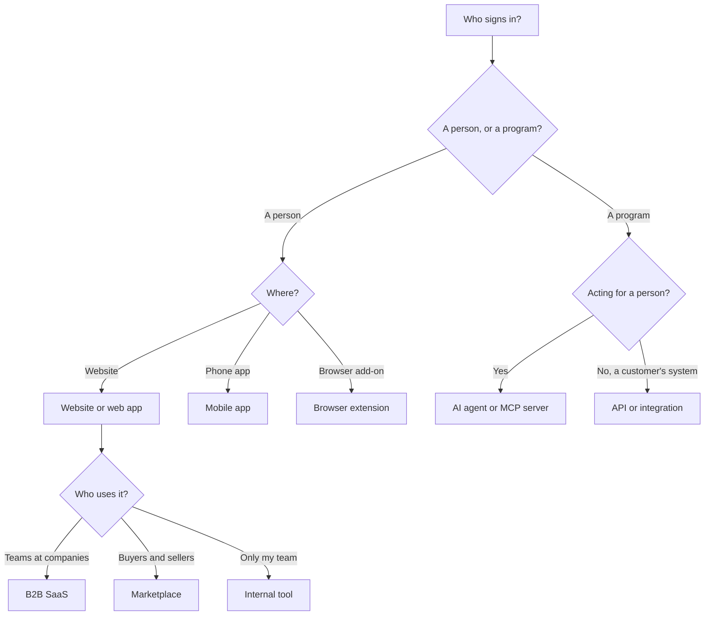

# Auth by app type

**Last verified:** 2026-11-19

**Who this is for:** Anyone deciding how people (or programs) will sign in to
what they're building, or checking that what an AI tool set up for them makes
sense.
**What you'll learn:** the sign-in methods available, how a login is
"remembered", and the recommended setup for eight kinds of app, from a simple
website to an AI agent acting on someone's behalf.

The examples use Supabase Auth, but the ideas apply to any auth provider.

## 1. Two jobs, two words

- **[Authentication](../glossary.md#authentication)** answers *"who are
  you?"* This is signing in.
- **[Authorization](../glossary.md#authorization)** answers *"what are you
  allowed to do?"* This is permissions: your
  [Row Level Security](../glossary.md#row-level-security-rls) policies and any
  checks in your server code.

Most beginner disasters happen in the gap between them. Someone signs in
perfectly well, then the app lets them see everyone's data. This guide is
about authentication, but every section ends by pointing you back to
authorization, because you need both.

## 2. Sign-in methods compared

| Method | What it is | Good for | Watch out for |
| --- | --- | --- | --- |
| **Email and password** | The classic | Most apps, and people expect it | Supabase recommends a minimum length of at least 8 characters, and blocking known leaked passwords (a Pro plan feature) |
| **[Magic link](../glossary.md#magic-link) or one-time code** | Supabase emails a link or code. Links are one-time use | Apps people use occasionally | Relies on email arriving fast. Supabase's production checklist recommends custom SMTP, so emails come from your own domain |
| **Social login ([OAuth](../glossary.md#oauth))** | "Sign in with Google/GitHub/Apple" | Consumer apps, developer tools | You depend on that provider. Each one needs its own setup and redirect URLs |
| **[Passkeys](../glossary.md#passkey)** | Sign in with a fingerprint, face or device PIN instead of a password | Anyone who'll accept something new | The FIDO Alliance calls them "phishing resistant and secure by design", but Supabase's support is **experimental**, so the API may change |
| **[Enterprise single sign-on (SSO)](../glossary.md#single-sign-on-sso)** | Staff sign in through their company's identity provider, like Okta or Microsoft Entra | B2B apps sold to larger companies | On Supabase, SAML SSO needs the Pro plan or above. Add it when a customer asks, not before |
| **Anonymous sign-in** | Creates a real user with no email, so people can try before signing up | Shopping carts, trials, games | Supabase "strongly recommends" CAPTCHA or Cloudflare Turnstile, because bots can fill your database with fake users |

Sources:
[Supabase: Password security](https://supabase.com/docs/guides/auth/password-security)
· [Supabase: Magic links and OTPs](https://supabase.com/docs/guides/auth/auth-magic-link)
· [Supabase: Social login](https://supabase.com/docs/guides/auth/social-login)
· [Supabase: Passkeys](https://supabase.com/docs/guides/auth/passkeys)
· [FIDO Alliance: Passkeys](https://fidoalliance.org/passkeys/)
· [Supabase: SAML SSO](https://supabase.com/docs/guides/auth/enterprise-sso/auth-sso-saml)
· [Supabase: Anonymous sign-ins](https://supabase.com/docs/guides/auth/auth-anonymous)
· [Supabase: Production security checklist](https://supabase.com/docs/guides/security/production-checklist)

**Whatever you pick, use a ready-made auth system.** Don't build your own.
See the [security checklist](../checklists/01-security.md#use-a-ready-made-login-system).

## 3. How your app remembers someone is signed in

After someone signs in, your app holds a **[session](../glossary.md#session)**.
In Supabase it's two things:

- an **access token** (a [JWT](../glossary.md#jwt), a signed digital pass),
  usually valid for 5 minutes to 1 hour
- a **refresh token**, which can be used once to get a new pair

[Supabase: User sessions](https://supabase.com/docs/guides/auth/sessions)

Where that session is stored matters:

- **Browser-only apps** (everything runs in the browser) keep it in the
  browser's storage. OWASP advises against storing session identifiers in
  local storage, "as the data is always accessible by JavaScript". If an
  attacker gets their script into your page (an XSS attack), they can read
  it. In practice, that makes protecting your page from injected scripts part
  of protecting your logins.
  [OWASP: HTML5 Security, Local Storage](https://cheatsheetseries.owasp.org/cheatsheets/HTML5_Security_Cheat_Sheet.html#local-storage)
- **Server-rendered apps** (Next.js, SvelteKit and similar) keep it in
  cookies, so both the browser and your server can see who's signed in.
  [Supabase: Server-side rendering](https://supabase.com/docs/guides/auth/server-side)

**One rule for server code:** Supabase's docs say to *never* trust
`supabase.auth.getSession()` in server code, because anyone can forge the
session cookie. Use `supabase.auth.getClaims()`, which verifies the token.
[Supabase: Creating a server client](https://supabase.com/docs/guides/auth/server-side/creating-a-client)

## 4. By app type

Not sure which type you are? Start here:

### Website or web app

- **What's different:** Nothing. This is the default case the rest builds on.
- **Recommended setup:** Email and password or a magic link, plus social
  login if your audience expects it. Turn on email confirmation. If you use a
  server-rendered framework, use Supabase's cookie-based server setup.
- **Watch out for:**
  - Redirect URLs: Supabase lets you use wildcards (`**`) for local
    development and preview links, but recommends setting the exact URL in
    production.
    [Supabase: Redirect URLs](https://supabase.com/docs/guides/auth/redirect-urls)
  - `getSession()` in server code (see above).
- **Then check:** the [security checklist](../checklists/01-security.md).

### Mobile app

- **What's different:** Your app is a file people download, so anything in it
  can be extracted. Sign-in links and social logins have to bounce back into
  the app. That's what a **[deep link](../glossary.md#deep-link)** does.
- **Recommended setup:**
  - Do social login in the **system browser**, not a web view inside your
    app. The OAuth standard for native apps calls the external browser "the
    best current practice", and requires
    **[PKCE](../glossary.md#pkce)**: a one-time secret that stops an
    intercepted login code from being used by another app.
    [RFC 8252: OAuth for native apps](https://datatracker.ietf.org/doc/html/rfc8252)
  - Set up deep linking so email links and OAuth redirects open the right
    screen.
    [Supabase: Native mobile deep linking](https://supabase.com/docs/guides/auth/native-mobile-deep-linking)
- **Watch out for:** a secret key in the app. Supabase's rule: for "anything
  you ship: browser, mobile app, CLI, script", use the publishable key only.
  [Supabase: API keys](https://supabase.com/docs/guides/getting-started/api-keys)

### B2B SaaS (teams and companies)

- **What's different:** People belong to organisations, and data belongs to
  the organisation. Larger customers will ask for SSO and MFA.
- **Recommended setup:**
  - Model organisations and memberships in your database. The
    [database design guide](database-design.md#apps-where-teams-share-data)
    shows the tables and a tested policy.
  - Invite people by email rather than letting anyone join any organisation.
  - Store roles (owner, member) in tables, or as custom claims added by a
    Supabase Auth Hook, **never** in `user_metadata`, which users can edit.
    [Supabase: Custom claims and RBAC](https://supabase.com/docs/guides/api/custom-claims-and-role-based-access-control-rbac)
  - Offer **[MFA](../glossary.md#multi-factor-authentication-mfa)**, and
    enforce it where it matters. Supabase records whether a session used a
    second factor (`aal2`) in the token, so policies can require it.
    [Supabase: MFA](https://supabase.com/docs/guides/auth/auth-mfa)
- **Watch out for:** adding SAML SSO before anyone needs it. It's a Pro-plan
  feature with per-customer setup.

### Marketplace (two kinds of user)

- **What's different:** Buyers and sellers, or clients and freelancers, see
  different screens and different data.
- **Recommended setup:** **One** auth system and one set of users, with the
  user's type stored as a role. Don't build two separate login systems.
  Someone can be both a buyer and a seller, and two systems means two of
  everything to secure. Roles work the same way as in B2B: a table or custom
  claims, never `user_metadata`.
  [Supabase: Custom claims and RBAC](https://supabase.com/docs/guides/api/custom-claims-and-role-based-access-control-rbac)
- **Watch out for:** showing or hiding seller features only in the frontend.
  Hidden buttons aren't security. The server or your RLS policies must check
  the role too.
- **Out of scope here:** paying sellers and verifying their identity. Your
  payments provider handles that, and its own docs come first.

### Internal tool or admin panel

- **What's different:** Only people you choose should ever get in, and they
  usually have powerful access.
- **Recommended setup:**
  - Turn **off** "Allow new users to sign up". Supabase's docs say that
    then "only existing users can sign in".
    [Supabase: General configuration](https://supabase.com/docs/guides/auth/general-configuration)
  - Add people by invitation. Supabase can send an invite link by email.
    [Supabase: Invite a user](https://supabase.com/docs/reference/javascript/auth-admin-inviteuserbyemail)
  - Require MFA for everyone.
- **Watch out for:** the login page being the *only* protection. Admin data
  still needs RLS or server-side checks.

### API or integration (a customer's system calls yours)

- **What's different:** No person types a password. A program sends a key
  with every request.
- **Recommended setup**, from OWASP's REST security guidance:
  - Require an **[API key](../glossary.md#api-key)** on every request.
  - Return `429 Too Many Requests` when a client calls too fast.
  - Be able to **revoke** a key if a client breaks the rules.
  - Don't rely on API keys alone for sensitive data.

  [OWASP: REST Security, API keys](https://cheatsheetseries.owasp.org/cheatsheets/REST_Security_Cheat_Sheet.html#api-keys)
- **If other apps act on behalf of *your users*,** for example a "Sign in
  with your app" button or a third-party integration, use OAuth instead of
  asking people to paste keys. Supabase can act as an OAuth 2.1 provider for
  this.
  [Supabase: OAuth 2.1 server](https://supabase.com/docs/guides/auth/oauth-server)
- **Watch out for:** older OAuth shortcuts. The current OAuth security
  guidance says clients "SHOULD NOT use the implicit grant".
  [RFC 9700: OAuth 2.0 security best practice](https://datatracker.ietf.org/doc/html/rfc9700)

### AI agent or MCP server

An AI agent (an assistant that takes actions, not just answers) increasingly
needs to act *for* a user, for example reading their orders or booking a
meeting. **[MCP](../glossary.md#model-context-protocol-mcp)** (the Model
Context Protocol) is an open standard for connecting agents to tools and
data.

- **What's different:** Software, not a person, holds the access. It may do
  things nobody watched it do.
- **Recommended setup:**
  - **Use OAuth, never a shared password or secret key.** MCP's
    authorization standard is built on OAuth 2.1. The user approves access,
    and the agent gets its own token that can be revoked. Supabase Auth can
    act as the OAuth provider for your MCP server.
    [MCP: Authorization](https://modelcontextprotocol.io/specification/latest/basic/authorization)
    · [Supabase: MCP authentication](https://supabase.com/docs/guides/auth/oauth-server/mcp-authentication)
  - **Check a token was issued for *your* server.** The MCP spec says servers
    "MUST validate that access tokens were issued specifically for them" and
    "MUST NOT accept or transit any other tokens".
  - **Least privilege:** OWASP says to "grant agents the minimum tools
    required for their specific task".
    [OWASP: AI Agent Security](https://cheatsheetseries.owasp.org/cheatsheets/AI_Agent_Security_Cheat_Sheet.html)
  - **A human approves the big things:** OWASP recommends requiring
    "explicit approval for high-impact or irreversible actions", like payments
    or deletions.
- **Watch out for:** *excessive agency*, OWASP's name for an AI system with
  more functions, permissions or autonomy than it needs.
  [OWASP GenAI: LLM06 Excessive Agency](https://genai.owasp.org/llmrisk/llm062025-excessive-agency/)
- **Note:** an MCP server that runs locally on someone's own computer
  (connected through "STDIO") doesn't use this OAuth flow. The spec says
  those should get credentials from the environment instead.

### Browser extension

- **What's different:** Like a mobile app, an extension is downloaded, so
  its code can be read by anyone.
- **Recommended setup:**
  - Publishable keys only. Never a secret key (the same Supabase rule as for
    mobile apps).
  - For OAuth sign-in, use the browser's built-in identity API
    (`launchWebAuthFlow`), which Chrome and Firefox both provide.
    [Chrome: identity API](https://developer.chrome.com/docs/extensions/reference/api/identity)
    · [MDN: WebExtensions identity](https://developer.mozilla.org/en-US/docs/Mozilla/Add-ons/WebExtensions/API/identity)
  - Keep sensitive work in the extension's background service worker, and
    don't pass secrets to content scripts (the part that runs inside web
    pages). That's Chrome's own security advice.
    [Chrome: Stay secure](https://developer.chrome.com/docs/extensions/develop/security-privacy/stay-secure)

## 5. The same three rules, whatever you build

1. **Use a ready-made auth system.** Don't write your own.
2. **Secret keys only on servers you control.** Never in a browser, app,
   extension or agent prompt.
3. **Authentication isn't authorization.** Every sign-in method still needs
   permission rules behind it.

## Check your work

- The [`auth-check`](../skills/auth-check/SKILL.md) skill reviews your auth
  settings and code, and explains what to fix.
- The [`supabase-rls-check`](../skills/supabase-rls-check/SKILL.md) skill
  covers the authorization side.

## Further reading

- [Supabase Auth docs](https://supabase.com/docs/guides/auth)
- [OWASP: Authentication Cheat Sheet](https://cheatsheetseries.owasp.org/cheatsheets/Authentication_Cheat_Sheet.html)
- [OWASP: Session Management Cheat Sheet](https://cheatsheetseries.owasp.org/cheatsheets/Session_Management_Cheat_Sheet.html)
- [OAuth for native apps (RFC 8252)](https://datatracker.ietf.org/doc/html/rfc8252)
