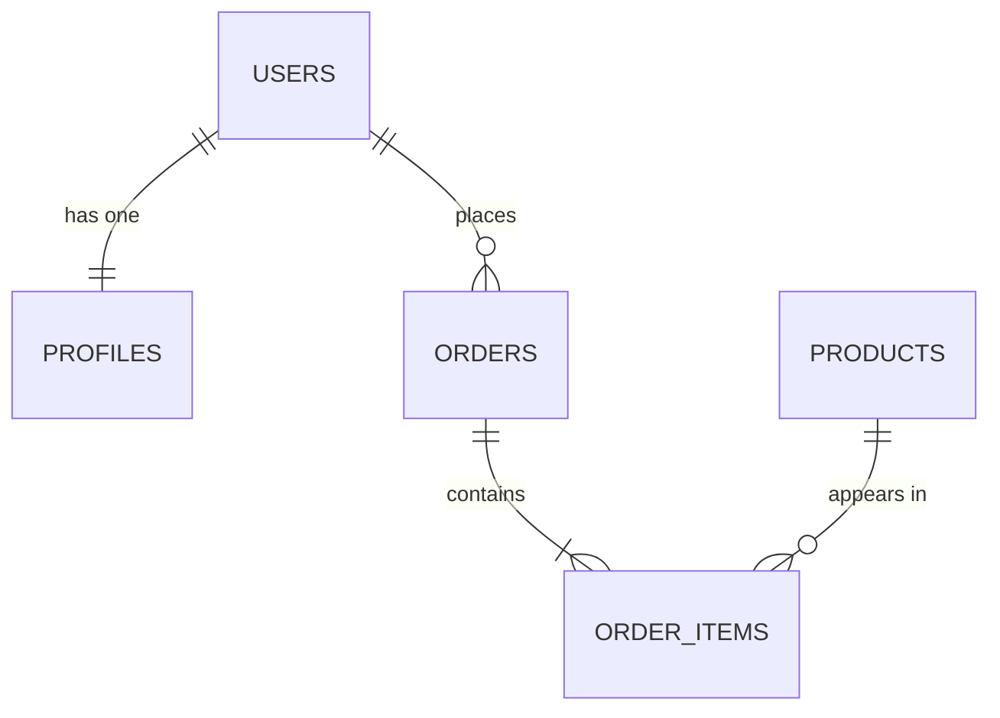
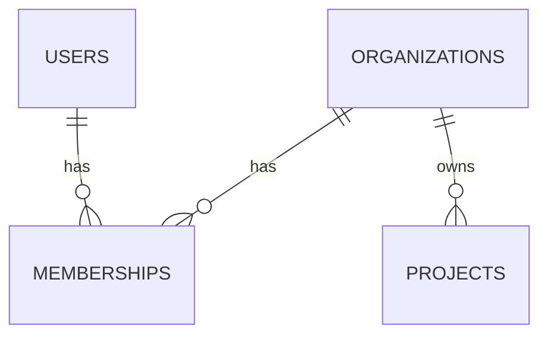

# Database design

**Last verified:** 2026-11-19

**Who this is for:** Anyone whose AI tool built them a database, and who
wants to understand it well enough to change it without breaking things.
**What you'll learn:** what tables, keys and relationships are, how to spot a
messy structure, and why the shape of your tables decides how easy your
permission rules are to get right.

The examples use Supabase, which runs on Postgres, but the ideas apply to any
**relational database** (a database that stores data in linked tables).
Every SQL example in this guide was tested on Postgres 17.

## 1. Tables are like spreadsheets, with rules

A **[table](../glossary.md#table)** holds one kind of thing, like
`products` or `orders`. Each **row** is one of those things, and each
**column** is one fact about it. Supabase's docs make the same comparison:
tables are like spreadsheets, with a few important differences.

The main differences are that every column has a fixed **type** (text, number,
date and so on), and that the database enforces rules you set, like "price
can't be negative".
[Supabase: Tables and data](https://supabase.com/docs/guides/database/tables)

**Start on paper, not in the tool.** List the *nouns* in your app: customers,
products, orders. Each noun is usually a table. Then list what you need to
know about each one. Those are its columns.

## 2. Give every table a primary key

A **[primary key](../glossary.md#primary-key)** is a column whose value is
unique for every row, like a passport number for that row. Supabase's advice
is to create one for every table. It's common to use either a numbered
`identity` column or a `uuid` (a long random ID).
[Supabase: Primary keys](https://supabase.com/docs/guides/database/tables#primary-keys)

```sql
create table public.products (
  id bigint generated always as identity primary key,
  name text not null,
  price_cents integer not null check (price_cents >= 0),
  created_at timestamptz not null default now()
);
```

## 3. Link tables with foreign keys

A **[foreign key](../glossary.md#foreign-key)** is a column that points at
another table's primary key. It's how you say "this order belongs to that
customer". The database then refuses links to rows that don't exist.
[Supabase: Joining tables with foreign keys](https://supabase.com/docs/guides/database/tables#joining-tables-with-foreign-keys)

There are three shapes of **[relationship](../glossary.md#relationship)**:

| Shape | Plain English | Example | How to build it |
| --- | --- | --- | --- |
| One-to-one | Each A has at most one B | Each user has one profile | B's primary key is also a foreign key to A |
| One-to-many | Each A has many Bs | Each user has many orders | B gets a foreign key column pointing at A |
| Many-to-many | Each A has many Bs, and each B has many As | An order contains many products, and a product appears in many orders | A **[join table](../glossary.md#join-table)** in the middle, with a foreign key to each side |

Here's a small shop. The diagram is drawn from text, so you can edit it like
code, and GitHub
[renders it](https://docs.github.com/en/get-started/writing-on-github/working-with-advanced-formatting/creating-diagrams)
as a picture:



`users` is Supabase's built-in `auth.users` table, which your login system
manages. The rest is yours:

```sql
-- One-to-one: the profile's id IS the user's id.
create table public.profiles (
  id uuid primary key references auth.users (id) on delete cascade,
  display_name text not null,
  created_at timestamptz not null default now()
);

-- One-to-many: each order points at one user.
create table public.orders (
  id bigint generated always as identity primary key,
  user_id uuid not null references auth.users (id) on delete restrict,
  status text not null default 'pending' check (status in ('pending', 'paid', 'shipped')),
  created_at timestamptz not null default now()
);
create index on public.orders (user_id);

-- Many-to-many: order_items joins orders and products.
create table public.order_items (
  order_id bigint not null references public.orders (id) on delete cascade,
  product_id bigint not null references public.products (id) on delete restrict,
  quantity integer not null check (quantity > 0),
  unit_price_cents integer not null check (unit_price_cents >= 0),
  primary key (order_id, product_id)
);
create index on public.order_items (product_id);
```

Notice `unit_price_cents` on `order_items`. Product prices change, but an
order should remember what the customer actually paid. Copying the price at
the moment of sale is a deliberate choice, not a duplicate.

## 4. Store each fact once

If the same fact lives in two places, the two copies eventually disagree.
Microsoft's guide to **[normalization](../glossary.md#normalization)** (the
formal name for this) says redundant data "creates maintenance problems",
because a change has to be made the same way everywhere.
[Microsoft: Database normalization basics](https://learn.microsoft.com/en-us/previous-versions/troubleshoot/microsoft-365/microsoft-365-apps/access/database-normalization-description)

Signs your AI tool has duplicated data:

- A customer's email appears in both `profiles` and `orders`. Store it once,
  and link with a foreign key.
- Columns like `product_1`, `product_2`, `product_3`. That's a hidden
  many-to-many relationship that needs a join table.
- One text column holding a list, like `"red, blue, green"`. You can't
  reliably search or link it.

## 5. Decide what happens when something is deleted

When you delete a row that other rows point at, the foreign key decides what
happens. Postgres gives you a choice for each link:
[Postgres: Foreign keys](https://www.postgresql.org/docs/current/ddl-constraints.html#DDL-CONSTRAINTS-FK)

| Option | What happens | Use it when |
| --- | --- | --- |
| `on delete cascade` | The linked rows are deleted too | The child means nothing without its parent: delete an order, and its line items go with it |
| `on delete restrict` | The delete is refused | The child must be kept: you can't delete a customer who has orders (you probably need them for tax records) |
| `on delete set null` | The link is cleared, and the row stays | The child can stand alone: a post whose author left |

**Tested:** with the schema above, deleting an order removed its line items,
and deleting a user who had orders was refused.
[Supabase: Cascade deletes](https://supabase.com/docs/guides/database/postgres/cascade-deletes)

## 6. Let the database enforce your rules

A **[constraint](../glossary.md#constraint)** is a rule the database checks
on every write, however the data arrives: from your app, a script, or someone
skipping your app entirely. That's why it's stronger than a check in your
frontend.
[Postgres: Constraints](https://www.postgresql.org/docs/current/ddl-constraints.html)

| Constraint | Example | Stops |
| --- | --- | --- |
| `not null` | `name text not null` | Missing values |
| `check` | `check (quantity > 0)` | Impossible values (tested: a quantity of 0 was rejected) |
| `unique` | `email text unique` | Duplicates |
| Foreign key | `references public.orders (id)` | Links to rows that don't exist |

And pick types carefully:

- **Dates and times:** use `timestamptz` (timestamp *with* time zone). The
  Postgres project's own wiki says don't use plain `timestamp` to store
  points in time.
- **Money:** store whole cents in an `integer` (or use `numeric`). The same
  wiki says the `money` type "isn't actually very good for storing monetary
  values".

[Postgres wiki: Don't Do This](https://wiki.postgresql.org/wiki/Don%27t_Do_This)

## 7. Index the columns you search and link by

An **[index](../glossary.md#index)** is like the index at the back of a book:
it lets the database find rows without reading the whole table. Postgres
does **not** create an index for a foreign key automatically, so add one
yourself, as with `create index on public.orders (user_id)` above.
[Postgres: Foreign keys](https://www.postgresql.org/docs/current/ddl-constraints.html#DDL-CONSTRAINTS-FK)

This matters doubly for Row Level Security: Supabase recommends indexing the
columns your policies filter on, because a policy runs on every query.
[Supabase: RLS, add indexes](https://supabase.com/docs/guides/database/postgres/row-level-security#add-indexes)
· [Supabase: Managing indexes](https://supabase.com/docs/guides/database/postgres/indexes)

## 8. Your structure shapes your permissions

This is the part most guides skip. **[Row Level Security](../glossary.md#row-level-security-rls)**
policies are rules written in terms of your columns, so a clean structure
makes them simple, and a messy one makes them fragile.

### Apps where each user owns their data

Give each private table a `user_id` column that links to `auth.users`. The
policy is then one line: "you can see rows where `user_id` is you." The
[security checklist](../checklists/01-security.md#turn-on-row-level-security-for-every-table)
covers this.

### Apps where teams share data

Business apps (often called **[multi-tenant](../glossary.md#multi-tenant)**)
need organisations, people who belong to them, and data that belongs to the
organisation, not to one person. The structure that makes this safe is a
**memberships** join table:



```sql
create table public.organizations (
  id bigint generated always as identity primary key,
  name text not null
);

create table public.memberships (
  organization_id bigint not null references public.organizations (id) on delete cascade,
  user_id uuid not null references auth.users (id) on delete cascade,
  role text not null default 'member' check (role in ('owner', 'member')),
  primary key (organization_id, user_id)
);
create index on public.memberships (user_id);

create table public.projects (
  id bigint generated always as identity primary key,
  organization_id bigint not null references public.organizations (id) on delete cascade,
  name text not null
);
create index on public.projects (organization_id);
```

The policy says: "you can see a project if you're a member of its
organisation."

```sql
alter table public.projects enable row level security;
revoke all on table public.projects from anon, authenticated;
grant select on table public.projects to authenticated;

create policy "Members can read their organization's projects"
on public.projects for select
to authenticated
using (
  organization_id in (
    select organization_id from public.memberships
    where user_id = (select auth.uid())
  )
);
```

`memberships` needs RLS too, with a policy that lets people read their own
memberships, or the check above has nothing to look at. **Tested:** with two
organisations and a user in each, each user saw only their own
organisation's projects.

Two traps to know about:

- **Policies that read each other loop forever.** If table A's policy reads
  table B and B's policy reads A, Postgres raises an "infinite recursion"
  error. Supabase's guide shows how to avoid it.
  [Supabase: Avoid recursive policies](https://supabase.com/docs/guides/database/postgres/row-level-security#avoid-recursive-policies)
- **Don't put roles in `user_metadata`.** Users can edit it themselves.
  Supabase's guide to roles covers the safe way.
  [Supabase: Custom claims and role-based access control](https://supabase.com/docs/guides/api/custom-claims-and-role-based-access-control-rbac)

## 9. Change your structure safely

Once real people use your app, every change to your tables should be a
**[migration](../glossary.md#migration)**: a numbered SQL file, saved in Git,
that's tested before it reaches production. Clicking around in the dashboard
of your live database leaves no record and can't be undone. The
[data checklist](../checklists/02-data.md) covers how.

## Check your work

- The [`supabase-rls-check`](../skills/supabase-rls-check/SKILL.md) skill
  checks your permission rules.
- Supabase's **Security Advisor** and **Performance Advisor** flag tables
  without RLS, foreign keys without indexes, and more.
  [Supabase: Advisors](https://supabase.com/docs/guides/observability/advisors)
